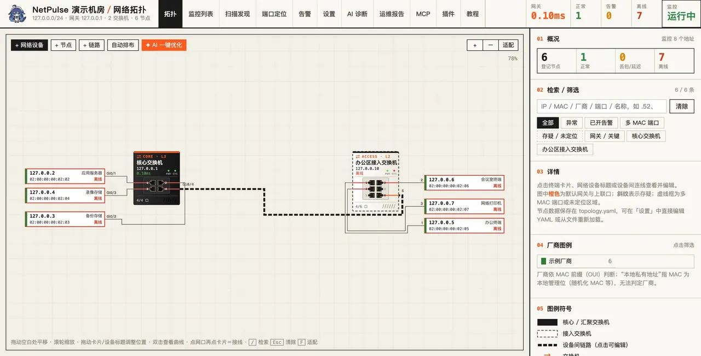
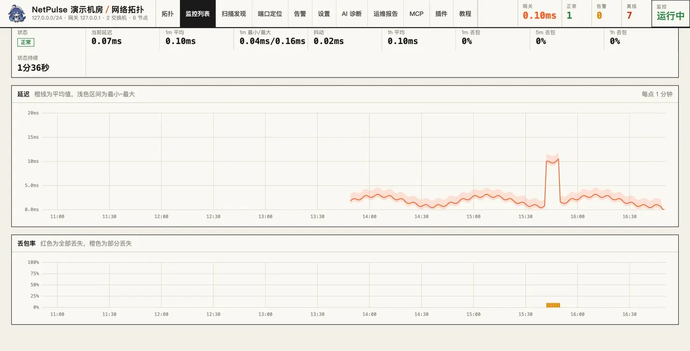

# 看清网络连接，及时发现异常。

网脉 **NetPulse** 是轻量的网络监控与智能诊断工具。常驻系统托盘，把设备、链路、延迟、丢包与现场诊断放在同一个页面。

## 运行截图

以下为系统在隔离演示环境中的实际运行截图。设备名称和 MAC 为虚构示例，探测地址仅使用本机回环地址；历史曲线使用示例数据，不包含真实机房信息。点击图片可查看大图。

### 网络拓扑

直观看到交换机、终端与上联关系，以及每台设备的实时探测状态。

### 监控列表

集中查看在线与离线状态、延迟、抖动、丢包率和最近探测走势。

### 设备历史曲线

通过平均延迟、最小至最大区间和丢包柱状图，观察异常发生的时间。下图历史样本为虚构演示数据。

## 从这里开始

1. 在 [GitHub Releases](https://github.com/chenlz22550/NetPulse/releases) 下载对应系统版本，或按 [开发与发布](development.md) 从源码构建。
2. 在运行程序的电脑上打开管理页面，设置登录密码（至少 6 位）。
3. 把虚构演示拓扑替换为自己的设备，再配置告警。

## 一套工具，覆盖日常运维

| 你想做什么 | 去哪里 |
|---|---|
| 看延迟、抖动、丢包和历史走势 | 监控列表、设备详情 |
| 看设备之间的接线关系 | 拓扑 |
| 查新设备、跟踪 IP 变化 | 扫描发现 |
| 查设备接在哪个交换机端口 | 端口定位 |
| 查看异常记录与配置通知渠道 | 告警、设置 |
| 分析多台同时离线、定位上游故障 | AI 诊断 |
| 汇总可用率与故障情况 | 运维报告 |
| 让外部 AI 客户端查询监控 | MCP |
| 扩展通知渠道、事件钩子与 AI 工具 | 插件 |

## 部署边界

Windows 7 / Server 2008 R2 及以上和 macOS；Windows 兼容构建使用 Go 1.20.14。管理网页需要现代浏览器。首次运行的拓扑完全虚构，必须替换；扫描与诊断只应针对你有权限管理的网络。

旧名 netPing 保留在可执行文件、数据目录和内部模块中。升级时可继续使用原目录。进一步阅读：[安装与首次运行](getting-started.md) · [拓扑字段参考](../docs/topology-fields.md) · [插件开发参考](../docs/plugin-development.md)。
